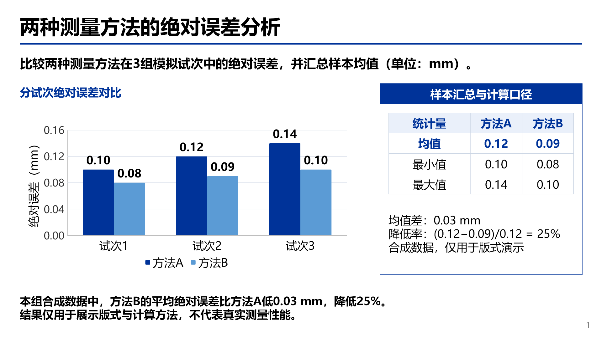
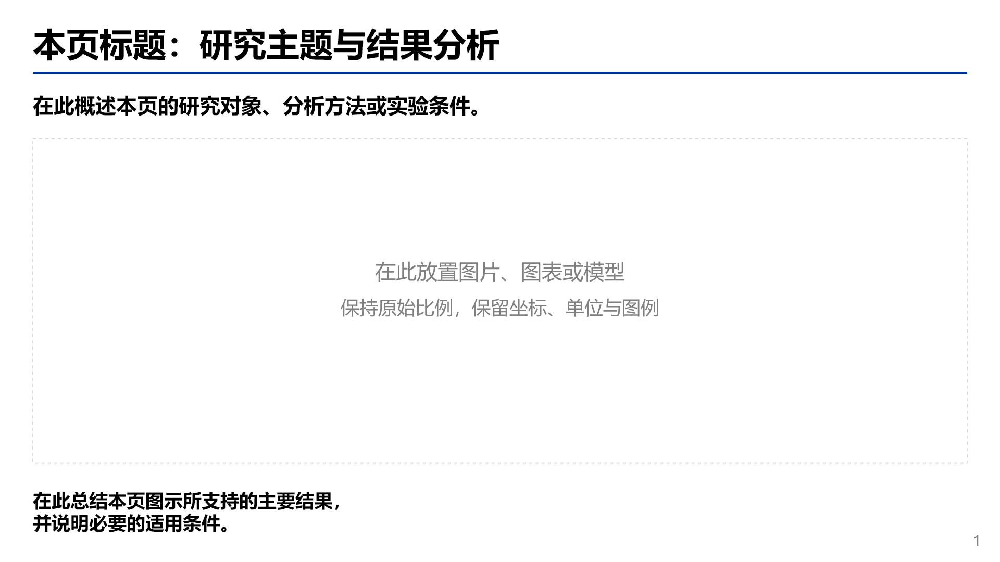

# 三明治 PPT

一个内置蓝色单页模板、也支持用户指定模板的演示文稿技能。内容页采用“上方说明、中部图证据、下方结论”，适合学术汇报与其他以图为主的报告。

它强调匹配真实模板的字体、字号、画幅和布局，保留标题、说明、结论与表格等对象的编辑能力，并让结论得到本页证据支持。封面、目录及用户明确指定的页面可以沿用其他布局。

默认用学术性主题标题概括页面内容，把具体发现留给下方结论；来源与原文页码记录在逐页备注中。中部可按内容关系选择细边框分组与深色标题栏，并保留组内、组间及结论区的留白，不要求每页都使用方框。用户指定的标题方式、引用要求和模板样式优先。

## 示例预览

下面是一页使用内置模板制作的完整示例，包含可编辑柱状图、统计表格和选择性分组框。所有数值均为人工设定的合成数据，仅用于演示排版与计算，不代表真实测量或算法性能。



[下载可编辑示例 PPTX](examples/synthetic-example.pptx) · [查看合成数据 CSV](examples/errors.csv)

## 使用

把技能目录放入使用环境支持的技能位置。在 Codex 中可放到项目的 `.agents/skills/sandwich-ppt/`，或个人的 `~/.agents/skills/sandwich-ppt/`。目录内保留 `SKILL.md`、`agents/`、`assets/`、`references/`、`scripts/` 和 `requirements.txt`。本地发现路径及调用方式以 [OpenAI 官方技能说明](https://learn.chatgpt.com/docs/build-skills) 为准。

提供内容材料和明确约束即可，例如：

```text
使用 $sandwich-ppt，按照默认模板制作 6 页 PPTX，不要封面。
内容页采用上方说明、中部图表、下方结论。
沿用模板字体字号，所有数据图保留单位，表格需要可编辑。
```

技能本身不绑定某个制作库、渲染器或其他技能。运行环境需要能编辑 PPTX；完成视觉验收还需要能渲染幻灯片。可使用环境里已有的演示文稿工具。未能渲染时应明确交付为尚未完成视觉验收的草稿。

用户另行提供模板或明确视觉方向时，以其要求为准；要求精确匹配外部模板却没有源文件时，需要说明缺失。只有截图时只能声称近似重建。这个仓库不包含原参考演示、科研图或字体文件。

## 默认模板

下载 [单页 PPTX 模板](assets/default-template.pptx)。模板为 16:9，微软雅黑，标题 32 pt、说明 20 pt、结论 18 pt；黑色标题下方设有与正文等宽的深蓝细分隔线，无封面。中部区域使用可替换的占位对象，详见 [默认格式说明](references/default-template.md)。



`examples/errors.csv` 保存示例使用的三组合成误差数据；完整示例及预览保存在 `examples/`。

## 可选的样式检查器

Python 3.10+，仅运行检查脚本及测试时需要安装 Python 依赖：

```sh
python -m pip install -r requirements.txt
python scripts/inspect_pptx_style.py "template.pptx" --slides 2,4-6 --output "style-report.json"
```

它以 UTF-8 JSON 输出显式格式、组合形状、表格文字及位置，不修改源稿。详细字段和限制见 [样式分析说明](references/style-inspection.md)。它不是完整的字体继承解析器，也不代替视觉检查。

## 测试与发布准备

```sh
python -m unittest discover -s tests -v
```

测试在临时目录生成合成 PPTX，无需私人文件。系统临时目录不可写时，可设置 `SANDWICH_TEST_TMPDIR` 为可写目录，如 `_local/tmp/`。测试范围和实际结果见 [TESTING.md](TESTING.md)。GitHub Actions 配置会在推送后执行 Windows/Linux 与 Python 3.10/3.12 的回归测试；配置存在不代表这些平台已实测通过。

## 本地开发目录与打包

与本项目相关的开发资料统一保存在项目内：手工测试案例的输入、构建和成品放入 `_local/cases/<case>/`，验证记录和备份放入 `_local/validation/`，临时图表数据放入 `_local/tmp/`。`tests/` 保留自动回归代码，`examples/` 仅保存可公开示例。

版本号记录在 `VERSION` 中。运行以下命令，会按明确的公开文件范围准备发布目录：

```sh
python scripts/prepare_release.py
```

当前版本的输出结构为：

```text
release/v0.1.0/
├── github-upload/             GitHub 网页上传用的公开文件
├── sandwich-ppt-v0.1.0.zip     下载安装包
└── RELEASE_NOTES.txt          版本说明
```

只生成 ZIP 时可运行 `python scripts/package_skill.py`。发布新版本时先更新 `VERSION`，再运行发布准备命令。已有的版本说明会保留，便于手工补充更新内容。

`_local/` 与 `release/` 已加入 `.gitignore`，也不进入发布包；打包脚本不会递归收集整个项目目录。更新技能时保留本地案例，将可复用的技能文件和合成示例纳入发布内容。

## 许可证

本项目采用 [MIT License](LICENSE)。Copyright (c) 2026 sandwich-ppt contributors。
